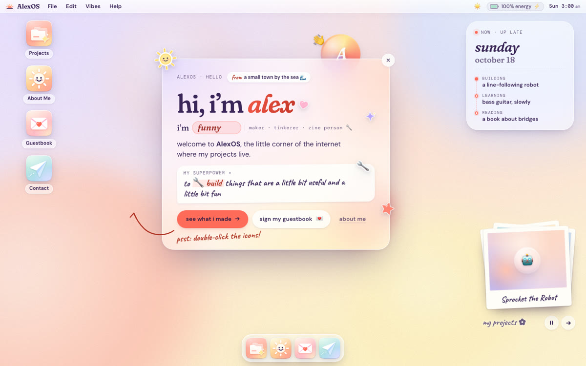
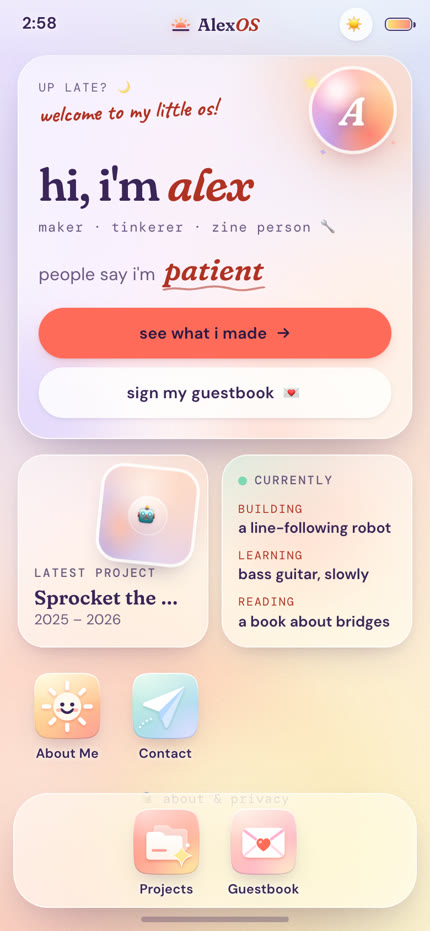

# my-tiny-os

**A personal website that's a tiny operating system, named after you.** Friends open your link and explore your projects the way they'd poke around your laptop. You don't write code: Claude interviews you, designs it around your personality and builds it.

<p>
  
  
</p>

**[See the live demo →](https://nina123123.github.io/my-tiny-os/)** The screenshots and the demo show a made-up person, *AlexOS*. Your site won't look like this: Claude restyles the colors, fonts, logo, wallpaper and wording to fit you.

[中文教程 →](README.zh-CN.md)

---

## Make yours in 4 steps

**You need:** a free [GitHub](https://github.com) account and [Claude Code](https://claude.ai/code), which needs a paid Claude plan.

1. **Copy the template.** Click **Use this template → Create a new repository** at the top of this page. Name it something like `my-site` and choose **Public**.
2. **Open it in Claude Code.**
   - In the browser: go to [claude.ai/code](https://claude.ai/code), connect GitHub, and pick your new repo.
   - On your computer: clone it and run `claude` inside the folder.
3. **Say "help me make my site"** (or type `/make-my-site`). Claude will:
   - ask you about 10 minutes of questions: who you are, who'll visit, the vibe, your projects
   - write your design brief to `docs/DESIGN.md`
   - make the site yours, then show you screenshots on desktop and phone
   - change one thing at a time, until you're happy
4. **Put it online.**
   - In your repo, go to **Settings → Pages → Source** and pick **GitHub Actions**.
   - Merge Claude's pull request, if you're using Claude Code in the browser.
   - About a minute later your site is live at `https://<your-username>.github.io/my-site/`.

Send the link to your group chat. 🎉

## What's inside

- **Two layouts, one OS:** on a computer you get a desktop, windows you can drag, and a dock. On a phone you get a home screen and full-screen apps.
- **Apps:**
  - **Projects** (the main one): each project gets a story, numbers that count up, photos and videos.
  - **About me**
  - **Guestbook**: friends leave a note.
  - **Contact**
  - **Hello**: a welcome card.
- **Three moods** (sunrise, sunset, night) and a living wallpaper.
- **Accessible:** keyboard navigation, screen-reader labels and reduced-motion support.

## Tips that make the result better

- **Be specific about your vibe.** Three adjectives, colors you love, and something you *don't* want ("not corporate", "not too pink") get you much further than "make it cool".
- **Real content wins.** Bring 3–5 projects, each with one number and 2–3 photos.
- **Change one thing at a time,** and point at screenshots: "this title is too thin", "make this button my accent color".
- **Before you share it,** ask Claude to "review the whole site like a picky friend: design, phone, accessibility, bugs, speed and wording".

## Optional: a real guestbook

The guestbook works right away in demo mode, where notes stay on each visitor's own device. To let everyone see everyone's notes, connect a free [Supabase](https://supabase.com) project. Claude walks you through it, and [docs/GUESTBOOK.md](docs/GUESTBOOK.md) has every step.

Only give Claude the **Project URL** and the **publishable key** (`sb_publishable_…`). Never share the secret key or the database password.

## For developers

```bash
npm install
npm run dev      # http://localhost:5173/?skipboot
npm run build    # type-check + production build into dist/
npm run lint
```

- All your content lives in `src/content/`.
- The colors, moods and fonts are in `src/styles/tokens.css`.
- [docs/EDITING.md](docs/EDITING.md) explains every content file.
- [docs/ARCHITECTURE.md](docs/ARCHITECTURE.md) explains how the pieces fit together.
- The Claude skill lives in `.claude/skills/make-my-site/`.

---

Created by [@nina123123](https://github.com/nina123123), from her own site. MIT licensed.
